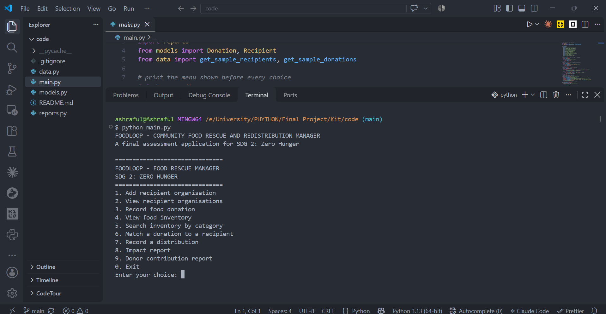
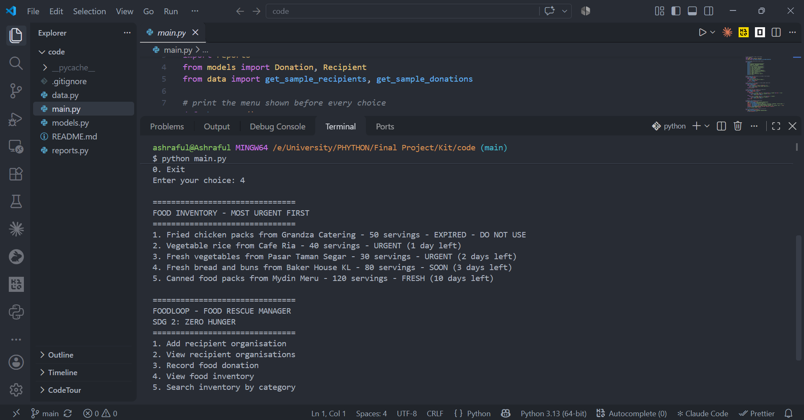
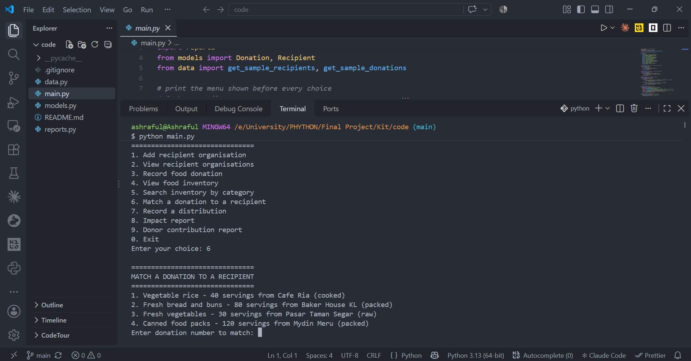
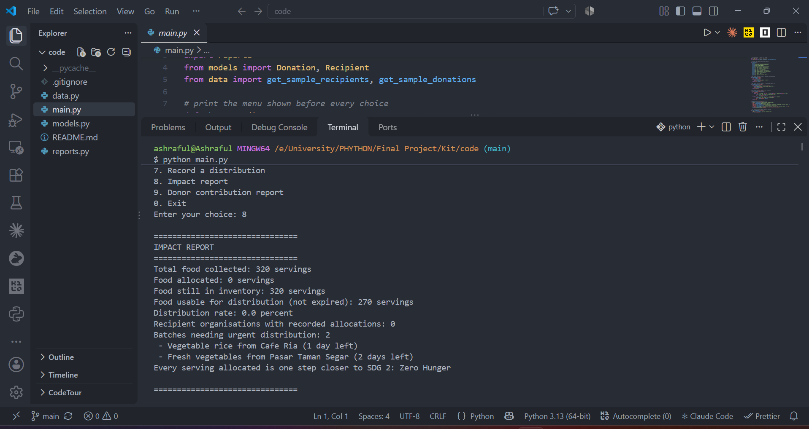
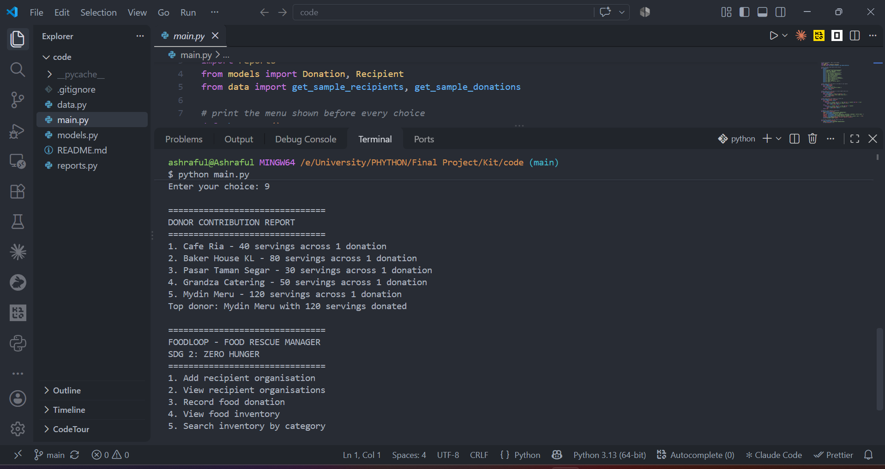

# FoodLoop - Community Food Rescue and Redistribution Manager


A menu-driven food rescue coordination program built in Python for the group final assessment in BIT1054 Fundamental of Computational Thinking. The program records surplus food donations, ranks them by expiry urgency, matches them to recipient organisations by category and capacity, records distributions, and reports the total servings allocated, with input validation on every prompt so wrong input never crashes the program.

Selected SDG: SDG 2 - Zero Hunger.

## Table of Contents

- [Features](#features)
- [Getting Started](#getting-started)
- [Usage](#usage)
- [Urgency and Matching Rules](#urgency-and-matching-rules)
- [Input Validation](#input-validation)
- [Project Structure](#project-structure)
- [Screenshots](#screenshots)
- [Team](#team)

## Features

- Menu-driven interface with nine options plus exit confirmation
- Recipient register with organisation type, storage capacity in servings and accepted food category
- Donation records with donor, food name, category, servings and days until expiry
- Inventory ranked most urgent first, with expired batches flagged as unsafe
- Inventory search by food category
- Recipient matching that checks category compatibility and remaining capacity
- Partial allocations capped by the batch size and the recipient's free space, with emptied batches removed
- Stock reconciliation in the impact report: collected = inventory + allocated, usable stock separated from expired batches, with the names of organisations holding recorded allocations and the urgent batches listed
- Donor contribution report with the total servings each donor has given and the top donor
- Input validation on every prompt

## Getting Started

### Prerequisites

- Python 3.6 or later

No external libraries are required. The program runs on the standard library alone.

### Running the Program

```bash
python main.py
```

The program starts with three sample recipients and five sample donations so every feature can be demonstrated immediately.

## Usage

| Option | Action |
|---|---|
| 1 | Add a recipient organisation |
| 2 | View all recipient organisations |
| 3 | Record a food donation |
| 4 | View the food inventory, ranked by expiry urgency |
| 5 | Search the inventory by food category |
| 6 | Match a donation to a recommended recipient |
| 7 | Record a distribution of a donation to a recipient |
| 8 | Show the impact report |
| 9 | Show the donor contribution report |
| 0 | Exit the program (asks for confirmation) |

## Urgency and Matching Rules

Every donation batch is labelled from its days until expiry:

| Days left | Label |
|---|---|
| 0 or less | EXPIRED - DO NOT USE (excluded from matching and distribution) |
| 1 to 2 | URGENT |
| 3 to 7 | SOON |
| 8 or more | FRESH |

Matching recommends the eligible recipient with the largest remaining capacity. A recipient is eligible when its accepted category matches the donation category (or it accepts any category) and it still has free space.

A distribution moves between 1 and the smaller of the batch size and the free space at the recipient. The batch shrinks by what is taken, the received total of the recipient grows by the same amount, and a batch that reaches zero is removed from the inventory.

## Input Validation

Every prompt checks its input and asks again on invalid entry:

| Invalid input | Program response |
|---|---|
| Menu choice outside 0 to 9 | Invalid choice, please enter 0 to 9. |
| Letters where a number is expected | Please enter a whole number above zero. |
| Zero or empty number field | Please enter a whole number above zero. |
| Food category other than cooked, raw or packed | Please type cooked, raw or packed. |
| Recipient category other than cooked, raw, packed or any | Please type cooked, raw, packed or any. |
| Empty or blank (spaces only) name field | This field cannot be empty. |
| Donation or recipient number not in the list | Invalid choice, try again. |
| Allocation above the allowed limit | Allocation must be between 1 and the limit. |
| Recipient that cannot take the donation | Rejected with a reason, nothing is recorded. |

## Project Structure

```
foodloop/
├── main.py      # menu loop, input screens, shared validators
├── models.py    # Donation and Recipient classes
├── reports.py   # inventory ranking, matching algorithm, impact report
├── data.py      # sample recipients and donations for the demonstration
├── screenshots/ # real terminal screenshots shown in this README
├── .gitignore   # keeps Python cache files out of the repository
└── README.md
```

## Screenshots

Main menu on startup:



Inventory ranked most urgent first, with the expired batch flagged:



Matching a donation to a recommended recipient:



Impact report:



Donor contribution report:



## Team

- **Islam Md Ashraful** (BCSSE)
- **Mahmud Husain** (BCSSE)
- **Samiur Md Shazzadul Amin** (BCSSE)

---

BIT1054 Fundamental of Computational Thinking, Final Assessment (group work, 40%).
Class 01-202609F0734, City University Malaysia.
